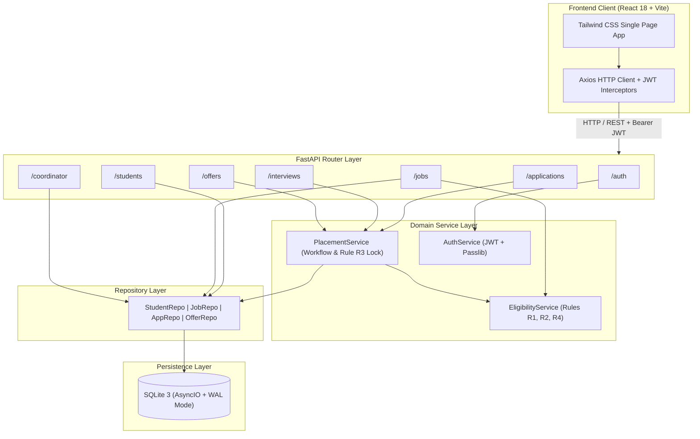
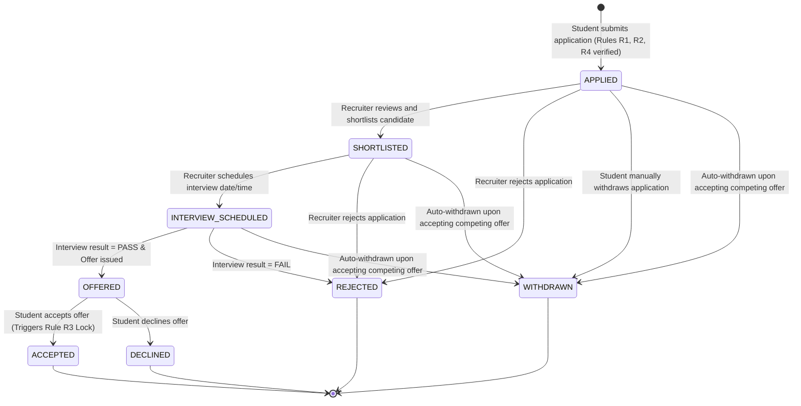

# TalentHub — Campus Placement Management System

[](https://fastapi.tiangolo.com)
[](https://react.dev/)
[](https://vitejs.dev/)
[](https://tailwindcss.com/)
[](https://www.sqlalchemy.org/)
[](https://www.python.org/)
[](https://opensource.org/licenses/MIT)

TalentHub is a production-grade, full-stack campus placement and recruitment portal built for academic institutions, recruiters, and students. It streamlines the end-to-end university recruitment lifecycle—from job posting, disciplinary branch filtering, and live eligibility checks, to interview scheduling, precondition-gated offer issuance, season-wide placement locks, and institutional coordinator governance.

---

## Table of Contents

- [Key Capabilities & Domain Rules](#key-capabilities--domain-rules)
- [System Architecture](#system-architecture)
- [Placement State Machine](#placement-state-machine)
- [Technology Stack](#technology-stack)
- [Directory Structure](#directory-structure)
- [Quick Start Guide](#quick-start-guide)
  - [Prerequisites](#prerequisites)
  - [1. Backend Setup](#1-backend-setup)
  - [2. Frontend Setup](#2-frontend-setup)
- [Pre-Seeded Demo Accounts](#pre-seeded-demo-accounts)
- [Role-by-Role Guided Walkthrough](#role-by-role-guided-walkthrough)
- [Automated Verification Suite](#automated-verification-suite)
- [API Reference](#api-reference)
- [Engineering Decisions & Audit](#engineering-decisions--audit)
- [License](#license)

---

## Key Capabilities & Domain Rules

TalentHub implements rigorous institutional placement policies and security controls across all domain entities:

### 1. Multi-Role Portals
- **Student Portal**: Live job eligibility transparency, USN and disciplinary branch tracking, resume link management, application status tracking, interview schedules, offer acceptance/rejection, and placed celebratory status.
- **Company / Recruiter Portal**: Drive lifecycle management, job listing posting, applicant pipeline management, interview scheduling with interviewer notes, pass/fail result recording, and cryptographically secured offer issuance.
- **Institutional Coordinator Portal**: Real-time institutional placement analytics, searchable and department-filtered student placement roster, CSV roster export, and administrative placement reset overrides.

### 2. Core Domain Rules
- **Rule R1: CGPA Cutoff Precision**: Quantized `Decimal` comparison to 2 decimal places with `ROUND_HALF_UP` precision, eliminating floating-point rounding anomalies.
- **Rule R2: Active vs. Cleared Backlogs**: Ceiling verification distinguishing active pending backlogs from cleared academic backlogs (`student.active_backlogs <= job.max_backlogs`).
- **Rule R3: Season-Wide One-Company Placement Lock**:
  - Once a candidate accepts an offer, the profile is atomically locked (`has_accepted_offer = True`).
  - All other active applications (`APPLIED`, `SHORTLISTED`, `INTERVIEW_SCHEDULED`) are automatically transitioned to `WITHDRAWN`.
  - All other pending offers are declined.
  - Subsequent applications to any company are strictly rejected with HTTP 400.
- **Rule R4: Disciplinary Branch Whitelist**:
  - Job listings specify whitelisted academic branches (e.g. `Computer Science, Information Technology` or `ALL`).
  - Live eligibility filtering and server-side validation strictly gate submissions against branch whitelists.
- **Offer Precondition Gating**: Recruiters cannot generate binding corporate offers without a completed interview marked with result `PASS`.
- **CSPRNG Offer Security**: 128-bit cryptographic tokens (`sec_offer_<16_hex>`) protect offer endpoints against Insecure Direct Object References (IDOR).
- **Data Integrity Constraints**: Composite database uniqueness constraint (`CONSTRAINT uq_student_job UNIQUE (student_id, job_id)`) preventing race conditions or duplicate applications.

---

## System Architecture

The application is structured following a strict **4-layer architectural pattern** with decoupled presentation, domain logic, data access, and persistence:



---

## Placement State Machine

Applications transition through a deterministic finite-state machine governed by institutional preconditions:



---

## Technology Stack

| Layer | Technologies | Key Highlights |
|:---|:---|:---|
| **Backend Framework** | [FastAPI](https://fastapi.tiangolo.com/) (0.115+) | High-performance async Python framework, automatic OpenAPI documentation |
| **Database & ORM** | [SQLAlchemy](https://www.sqlalchemy.org/) (2.0 Async), [aiosqlite](https://github.com/omnilib/aiosqlite) | Async SQLite engine with WAL mode and `PRAGMA foreign_keys = ON` |
| **Validation & Schemas**| [Pydantic](https://docs.pydantic.dev/) (v2.9+) | Strict data modeling, Decimal CGPA quantization, request/response validation |
| **Authentication** | [Python-Jose](https://github.com/mpdavis/python-jose), [Passlib](https://passlib.readthedocs.io/), [Bcrypt](https://pypi.org/project/bcrypt/) | Stateless JWT tokens, PBKDF2/Bcrypt password hashing, RBAC dependencies |
| **Frontend Framework** | [React](https://react.dev/) (18.2), [Vite](https://vitejs.dev/) (5.4) | Lightning-fast HMR dev server, optimized production build |
| **Styling & UI** | [Tailwind CSS](https://tailwindcss.com/) (3.4), [Lucide React](https://lucide.dev/) | Clean dark/slate aesthetic, responsive dashboards, iconography |
| **HTTP Client** | [Axios](https://axios-http.com/) (1.6+) | Centralized JWT auth interceptors, structured error handling |
| **Test Automation** | Python 3 Standard Library (`urllib`, `json`) | Multi-phase deterministic E2E verification suite (`verify_workflow.py`) |

---

## Directory Structure

```
aisd-talent-hub/
├── .gitignore                      # Git ignore rules for Python, Node, and SQLite
├── README.md                       # Comprehensive project documentation
├── backend/
│   ├── app/
│   │   ├── api/                    # FastAPI endpoint routers
│   │   │   ├── applications.py     # Application submission and withdrawal
│   │   │   ├── auth.py             # User login and JWT generation
│   │   │   ├── companies.py        # Company profile endpoints
│   │   │   ├── coordinator.py      # Institutional stats, roster, and placement reset
│   │   │   ├── interviews.py       # Interview scheduling and result recording
│   │   │   ├── jobs.py             # Job listing creation, retrieval, and active toggle
│   │   │   ├── offers.py           # Offer issuance and student response
│   │   │   └── students.py         # Student profile retrieval and resume updates
│   │   ├── core/
│   │   │   ├── database.py         # Async SQLite engine, sessionmaker, init_db
│   │   │   └── security.py         # Password hashing, JWT creation, RBAC guards
│   │   ├── models/
│   │   │   └── models.py           # SQLAlchemy declarative ORM models
│   │   ├── repositories/
│   │   │   └── repository.py       # Data access objects with save/list methods
│   │   ├── schemas/
│   │   │   └── schemas.py          # Pydantic request and response schemas
│   │   ├── services/
│   │   │   ├── eligibility_service.py # Rules R1, R2, R4 eligibility engine
│   │   │   ├── placement_service.py   # State transitions, Rule R3 lock, offer gating
│   │   │   └── serializers.py      # Entity serialization helpers
│   │   └── seed.py                 # Initial database seeding for demo personas
│   ├── main.py                     # FastAPI application entrypoint and lifespan events
│   └── requirements.txt            # Python dependencies
├── frontend/
│   ├── index.html                  # HTML template
│   ├── package.json                # Frontend npm dependencies and scripts
│   ├── postcss.config.js           # PostCSS configuration
│   ├── tailwind.config.js          # Tailwind CSS styling configuration
│   ├── vite.config.js              # Vite bundler configuration
│   └── src/
│       ├── App.jsx                 # Top-level view router and auth state
│       ├── api.js                  # Axios instance with Authorization headers
│       ├── index.css               # Global Tailwind CSS directives
│       ├── main.jsx                # React root entrypoint
│       ├── components/
│       │   ├── Header.jsx          # Navigation header with user badge & logout
│       │   └── StatusBadge.jsx     # Color-coded badges for application statuses
│       └── pages/
│           ├── CompanyDashboard.jsx     # Recruiter pipeline, jobs, and interviews
│           ├── CoordinatorDashboard.jsx # Analytics, roster, search, and CSV export
│           ├── Login.jsx                # Login screen with quick-fill persona buttons
│           └── StudentDashboard.jsx     # Eligibility, resume, applications & offers
├── scripts/
│   └── verify_workflow.py          # Deterministic E2E verification test suite
└── docs/
    ├── SILENT_DECISIONS.md         # Comprehensive engineering audit of 26 silent decisions
    └── Lab6_TalentHub_Silent_Decisions_Audit.docx # Formal Microsoft Word engineering report
```

---

## Quick Start Guide

### Prerequisites

Ensure you have the following installed on your machine:
- **Python 3.11+** (tested on Python 3.11, 3.12, and 3.13)
- **Node.js v18+** and **npm**
- **Git**

---

### 1. Backend Setup

Open a terminal window and execute:

```bash
# Navigate to the backend directory
cd backend

# Create a virtual environment
python3 -m venv venv

# Activate the virtual environment
# On macOS / Linux:
source venv/bin/activate
# On Windows (Command Prompt):
# venv\Scripts\activate.bat
# On Windows (PowerShell):
# .\venv\Scripts\Activate.ps1

# Install required dependencies
pip install -r requirements.txt

# Start the FastAPI backend server
uvicorn main:app --reload --port 8000
```

> [!NOTE]
> On the first startup, FastAPI automatically initializes `talenthub.db` (SQLite) and seeds all demo students, companies, job listings, and credentials.
> - **Interactive Swagger Docs**: Open [http://127.0.0.1:8000/docs](http://127.0.0.1:8000/docs)
> - **Interactive ReDoc**: Open [http://127.0.0.1:8000/redoc](http://127.0.0.1:8000/redoc)
> - **Root Health Check**: Open [http://127.0.0.1:8000/](http://127.0.0.1:8000/)

---

### 2. Frontend Setup

Open a second terminal window (leaving the backend running):

```bash
# Navigate to the frontend directory
cd frontend

# Install npm packages
npm install

# Start the Vite development server
npm run dev
```

Open [http://localhost:5173](http://localhost:5173) in your browser to access the TalentHub web interface.

---

## Pre-Seeded Demo Accounts

Every demo account uses the uniform password: **`password123`**. The login screen includes **1-click quick-fill buttons** for each persona.

| Persona | Role | Email | Academic / Company Profile | Purpose / Test Scenario |
|:---|:---:|:---|:---|:---|
| **Rahul Sharma** | `STUDENT` | `rahul@student.talenthub.edu` | USN: `1RV21CS001`<br>Branch: `Computer Science`<br>CGPA: `8.2` \| Backlogs: `1` | High-performing candidate eligible for standard tech drives; tests resume update and interview pipeline |
| **Priya Nair** | `STUDENT` | `priya@student.talenthub.edu` | USN: `1RV21IS045`<br>Branch: `Information Technology`<br>CGPA: `9.1` \| Backlogs: `0` | Elite scholar; tests multi-application, interview PASS, offer acceptance, and **Rule R3 auto-withdrawal** |
| **Aman Verma** | `STUDENT` | `aman@student.talenthub.edu` | USN: `1RV21EC089`<br>Branch: `Electronics`<br>CGPA: `6.4` \| Backlogs: `3` | Boundary persona; tests **Rule R1 (CGPA cutoff)** and **Rule R4 (Branch whitelist)** rejection |
| **ABC Technologies** | `COMPANY` | `hr@abctech.com` | Software Developer (7.0 CGPA, CS/IT)<br>QA Engineer (6.0 CGPA, All Branches) | Tier-1 recruiter; tests shortlisting, interview scheduling, and offer gating |
| **XYZ Corp** | `COMPANY` | `hr@xyzcorp.com` | Backend Engineer (8.0 CGPA, CS/IT, 10.0 LPA) | High-package drive; tests competitive hiring and offer issuance |
| **Placement Cell** | `COORDINATOR` | `coordinator@talenthub.edu` | Institutional Placement Administration | Institution-wide governance, roster review, CSV export, and placement resets |

---

## Role-by-Role Guided Walkthrough

### Scenario 1: Student Eligibility Transparency & Profile
1. Log in as **Aman Verma** (`aman@student.talenthub.edu`).
2. Observe live eligibility feedback on job listings:
   - *Software Developer* (ABC Tech): **Ineligible** (CGPA 6.4 < 7.0 and Electronics branch not allowed).
   - *QA Engineer* (ABC Tech): **Eligible** (CGPA 6.4 >= 6.0, backlogs 3 <= 3, all branches allowed).
3. Update your **Resume / Portfolio URL** in the profile card and click **Save**.
4. Apply to **QA Engineer**. Notice duplicate prevention if you try to submit again.

### Scenario 2: Recruiter Shortlisting, Interviewing & Offer Gating
1. Log out and log in as **ABC Technologies HR** (`hr@abctech.com`).
2. Go to **Applicants**. See Aman's application for QA Engineer along with his USN and resume link.
3. Click **Shortlist**.
4. Schedule an interview with date, time, and optional notes (e.g., `Technical Round 1`).
5. Notice that clicking **Issue Offer** before recording an interview result is strictly blocked.
6. Mark the interview result as **Pass**.
7. Enter the salary package (e.g., `6.5` LPA) and click **Issue Offer**. A secure offer token is minted.

### Scenario 3: Rule R3 One-Company Placement Lock
1. Log out and log in as **Priya Nair** (`priya@student.talenthub.edu`).
2. Priya has an active offer from XYZ Corp (10.0 LPA) and an active application at ABC Tech.
3. Click **Accept Offer** on the XYZ Corp offer.
4. **Instant Effects**:
   - Celebratory banner displays: *"Congratulations! You have accepted an offer from XYZ Corp."*
   - Priya's application to ABC Tech automatically transitions to **WITHDRAWN**.
   - All **Apply** buttons across the portal are permanently disabled.
   - Any API attempt to apply to new jobs returns HTTP 400.

### Scenario 4: Placement Coordinator Governance & Override
1. Log out and log in as **Placement Coordinator** (`coordinator@talenthub.edu`).
2. Review institution-wide statistics: total students, companies, active drives, total offers, and placement percentage.
3. Switch to the **Student Placement Roster** tab:
   - View all students with USN, branch, CGPA, backlogs, and placed status.
   - Use the live search bar or department filter (e.g. *Computer Science*, *Information Technology*).
   - Click **Export CSV** to download the official placement records spreadsheet.
4. Test administrative override: Click **Reset Placement** on a placed student to reopen their eligibility if an offer was rescinded or an exception was approved.

---

## Automated Verification Suite

TalentHub includes a fully automated end-to-end Python test suite that verifies all 8 operational phases without external test framework dependencies:

```bash
# Ensure the backend server is running on port 8000
python3 scripts/verify_workflow.py
```

### Verification Phases Executed:
- **Phase 1: Authentication & Identity Partitioning**: Verifies JWT issuance and linked IDs for all 6 demo accounts.
- **Phase 2: Student Domain Identifiers & Resume Tracking**: Verifies USN, branch integrity, and resume URL updates.
- **Phase 3: Deterministic Rule Checking (R1, R2, R4)**: Verifies CGPA floor, active backlog ceiling, and branch whitelist rejection.
- **Phase 4: Duplicate Submission Guard**: Verifies compound uniqueness constraint `uq_student_job`.
- **Phase 5: Multi-Application Pipeline**: Verifies concurrent application submissions across multiple companies.
- **Phase 6: Workflow Precondition Gating**: Verifies that offers cannot be generated without an interview result `PASS`.
- **Phase 7: Rule R3 Policy Lock & Auto-Withdrawal**: Verifies atomic candidate locking and auto-withdrawal of competing applications.
- **Phase 8: Coordinator Governance & Audit**: Verifies real-time institutional statistics, roster queries, and administrative reset.

---

## API Reference

The backend exposes a clean RESTful interface documented via OpenAPI:

| Method | Endpoint | Role | Description |
|:---|:---|:---:|:---|
| `POST` | `/auth/login` | Public | Authenticates credentials and returns JWT bearer token |
| `GET` | `/students/me` | `STUDENT` | Retrieves authenticated student profile, USN, and placement status |
| `PATCH`| `/students/me` | `STUDENT` | Updates student resume/portfolio URL |
| `GET` | `/jobs` | Any | Lists all job listings with live eligibility calculation for students |
| `POST` | `/jobs` | `COMPANY` | Creates a new job listing with CGPA, backlog, and branch criteria |
| `PATCH`| `/jobs/{id}/toggle-active` | `COMPANY`, `COORDINATOR` | Opens or closes a recruitment drive |
| `GET` | `/applications/me` | `STUDENT` | Retrieves candidate's applications, interview schedules, and offers |
| `POST` | `/applications` | `STUDENT` | Submits application after verifying Rules R1, R2, R3, and R4 |
| `PATCH`| `/applications/{id}/withdraw` | `STUDENT` | Manually withdraws an active job application |
| `PATCH`| `/applications/{id}/status` | `COMPANY` | Transitions application to `SHORTLISTED` or `REJECTED` |
| `POST` | `/interviews/schedule` | `COMPANY` | Schedules interview date/time with optional interviewer notes |
| `PATCH`| `/interviews/{app_id}/result` | `COMPANY` | Records interview outcome (`PASS` or `FAIL`) |
| `POST` | `/offers` | `COMPANY` | Issues binding corporate offer (preconditioned on interview `PASS`) |
| `PATCH`| `/offers/{app_id}/respond` | `STUDENT` | Accepts (triggers Rule R3 lock) or declines offer |
| `GET` | `/coordinator/stats` | `COORDINATOR` | Institutional placement analytics and KPIs |
| `GET` | `/coordinator/students` | `COORDINATOR` | Institution-wide student roster with placement indicators |
| `PATCH`| `/coordinator/students/{id}/reset-placement` | `COORDINATOR` | Administrative override resetting student placement lock |

---

## Engineering Decisions & Audit

During the realization of TalentHub v2, 26 domain, architectural, security, and UX ambiguities were identified and systematically resolved. The full traceability matrix and engineering rationale are documented in:
- Markdown Specification: [docs/SILENT_DECISIONS.md](docs/SILENT_DECISIONS.md)
- Formal Audit Document: [docs/Lab6_TalentHub_Silent_Decisions_Audit.docx](docs/Lab6_TalentHub_Silent_Decisions_Audit.docx)

---

## License

This project is licensed under the MIT License — see the [LICENSE](LICENSE) file for details.
